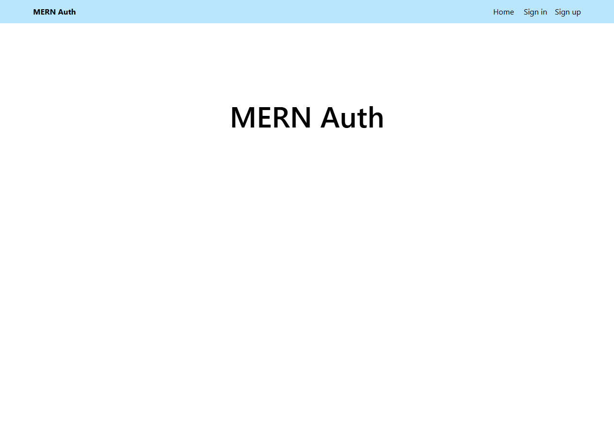
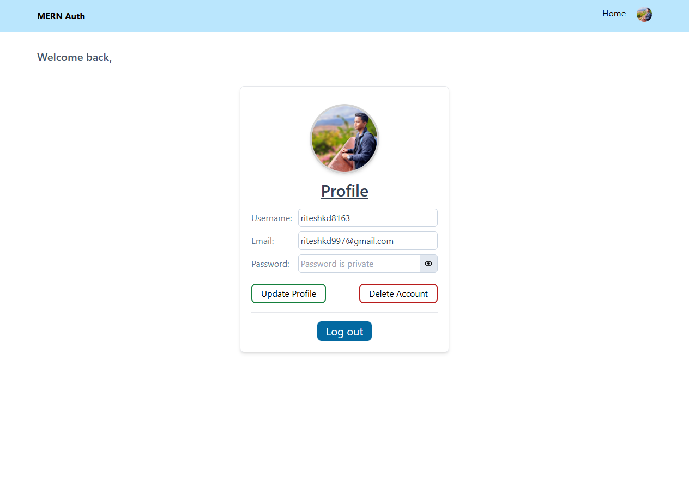
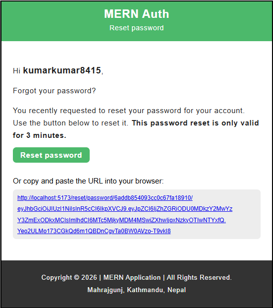

# MERN Stack Authentication App

A full-stack authentication application built with the **MERN Stack**. The project provides user registration, login, Google authentication, password reset through email, protected routes, and user profile management.

### NOTE:

- document of this project is in document folder.

## Live Demo

**Live Application:** https://mern-auth-app-rm8f.onrender.com/

## Features

- User registration and login
- Secure password hashing with **bcryptjs**
- JWT-based authentication
- HTTP-only authentication cookies
- Google authentication
- Forgot password functionality
- Password reset through email
- Protected dashboard route
- User profile management
- Profile picture support
- MongoDB database integration
- Responsive UI with Tailwind CSS
- Production deployment with Render

## Tech Stack

### Frontend

- React
- React Router
- Redux Toolkit
- Tailwind CSS
- Vite

### Backend

- Node.js
- Express.js
- MongoDB
- Mongoose
- JSON Web Token (JWT)
- bcryptjs
- Nodemailer
- Cookie Parser

### Deployment

- GitHub
- Render

## Project Structure

```text
mern-auth-app/
│
├── api/
│   ├── controllers/
│   ├── models/
│   ├── routes/
│   └── index.js
│
├── client/
│   ├── src/
│   │   ├── components/
│   │   ├── pages/
│   │   ├── redux/
│   │   └── App.jsx
│   └── package.json
│
├── .env
├── package.json
└── README.md
```

## Installation

### 1. Clone the repository

```bash
git clone <https://github.com/riteshchaudhary375/mern-auth-app.git>
cd mern-auth-app
```

### 2. Install dependencies

Install backend dependencies:

```bash
npm install
```

Install frontend dependencies:

```bash
cd client
npm install
cd ..
```

### 3. Configure Environment Variables

Create a `.env` file in the project root:

```env
MONGO=your_mongodb_connection_string
JWT_SECRET=your_jwt_secret
API_PORT=3000
FRONTEND_URL=http://localhost:5173
SALT_ROUNDS=10

EMAIL=your_gmail_address
PASSWORD=your_google_app_password
```

> **Important:** Never commit `.env` or expose database credentials, passwords, JWT secrets, or email credentials in GitHub. Use environment variables provided by your hosting platform for production.

## Run Locally

Start the development server:

```bash
npm run dev
```

The application will run on:

```text
http://localhost:3000
```

The frontend development server can be accessed through the Vite development URL when running the client separately.

## Authentication Flow

```text
User
 │
 ├── Sign Up
 │      ↓
 │   Password Hashing
 │      ↓
 │   MongoDB
 │
 ├── Sign In
 │      ↓
 │   JWT Authentication
 │      ↓
 │   HTTP-Only Cookie
 │
 └── Forgot Password
        ↓
     Email Verification
        ↓
     Reset Password
        ↓
     Updated Password
```

## Main Authentication Features

### Sign Up

Creates a new user account and securely hashes the user's password before storing it in MongoDB.

### Sign In

Authenticates the user and creates an authentication token stored in an HTTP-only cookie.

### Google Authentication

Allows users to authenticate using their Google account.

### Forgot Password

Users can request a password reset link using their registered email address. Nodemailer sends the reset link through Gmail.

### Protected Routes

Authenticated users can access protected pages such as the dashboard, while unauthenticated users are redirected to the sign-in page.

## Production Deployment

The application is deployed using **Render**.

The deployment workflow is:

```text
VS Code
   ↓
Git Commit
   ↓
GitHub
   ↓
Render detects changes
   ↓
Render builds application
   ↓
Latest successful version deployed
```

Production environment variables should be configured directly in Render rather than committing sensitive values to the repository.

## Security Notes

- Store sensitive credentials in environment variables.
- Never commit `.env` to GitHub.
- Use a Google App Password for Gmail SMTP.
- Use a strong JWT secret.
- Do not expose authentication credentials in frontend code.

## Author

**Ritesh Chaudhary**

BSc (Hons) Computing Graduate  
Interested in Full-Stack Development, Data Analysis, and Software Engineering.

## License

This project is licensed under the **ISC License**.

---

### 1. Home Page View



---

### 2. Profile Page View



---

### 3. Email Message View



- More view images are in **Preview** folder.
